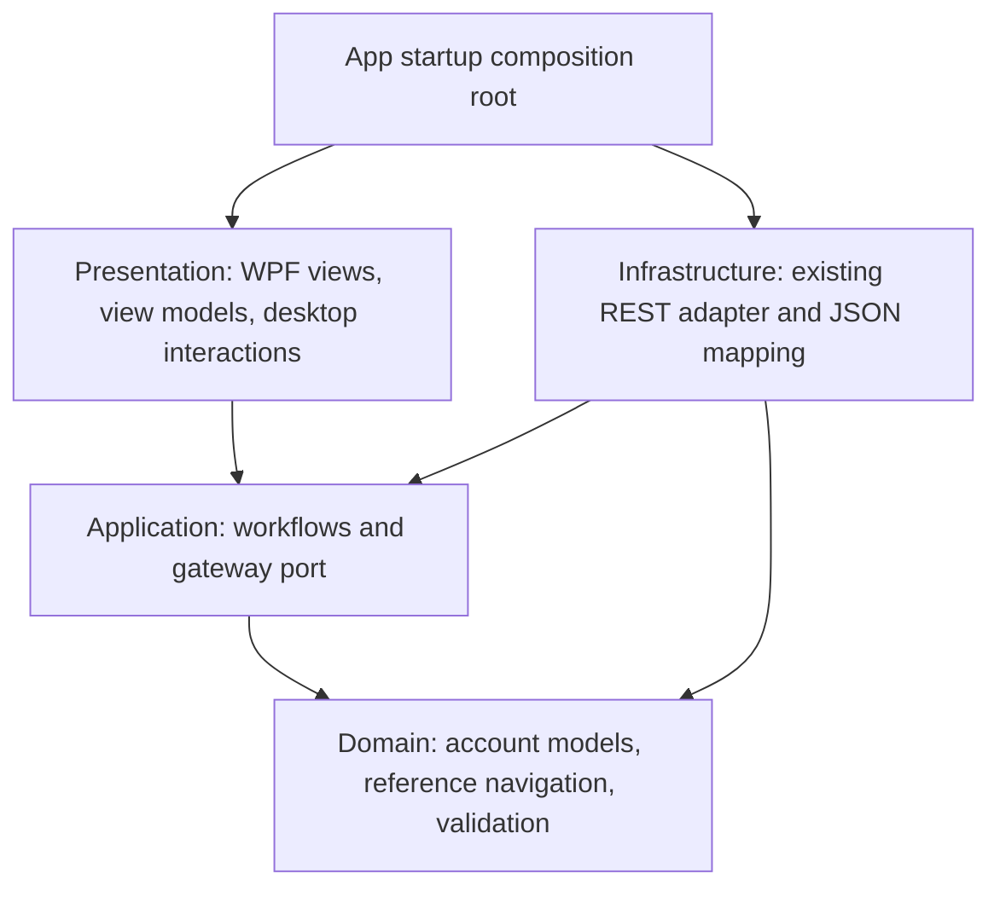

# Windows reconstruction architecture — 0.5 JSR checkpoint

## Scope and status

The application remains incomplete. This checkpoint migrates the main shell to .NET 10 and MVVM, introduces four project layers, and preserves the earlier offline editor as an explicitly transitional view. It does not claim Android feature parity, complete MVVM conversion, or verified production compatibility.

The earlier `work/windows` project and preview 0.3 are preserved as a behavioral baseline. The migration project is `work/windows-next/Mskpy.sln`.

The new JSR workflow has domain definitions (`JsrForm`), an application workflow/document port (`JsrWorkflow`, `IJsrDocuments`), file-backed infrastructure (`JsrDocuments`), a presentation view model (`JsrViewModel`) and a bound WPF view (`JsrWindow`). Its code-behind handles only view initialization, lifetime and the unsaved-change prompt. Platform photo decoding/file dialogs are presentation services; no WPF type is introduced into Domain, Application or Infrastructure.

The JSR draft is explicitly a local document format, not a backend submission DTO. The original record is retained as an opaque JSON string; no inspection coordinates, timestamps, signatures, account identifiers or submission-tail values are manufactured. Chosen image paths are checked against their file hashes on reopening/saving. Unknown/null draft answer values and invalid photo references are rejected.

Selection controls use a shared dark, non-editable template. The named popup and item presenter are retained following the [Microsoft WPF ComboBox template contract](https://learn.microsoft.com/en-us/dotnet/desktop/wpf/controls/combobox). Binding and template-part checks pass; physical keyboard/popup interaction still needs interactive testing.

## Dependency boundaries

- Domain has no WPF, HTTP, SQLite or infrastructure project dependency. Existing validation namespaces are retained to minimize behavioral changes.
- Application owns sign-in validation and the interface used by view models. Its transfer document includes opaque original JSON solely for the legacy editor; this is not a domain model.
- Infrastructure wraps the previous REST implementation, keeps tokens out of display models, and maps transport failures. It contains no desktop view types.
- Presentation has bound commands and observable state. The main window code-behind initializes the view and exposes a password-input adapter; it has no login, list, filtering, or navigation policy.
- App startup is the composition root. It constructs services and view models explicitly; there is no service locator or container dependency.

## State and network behavior

- Passwords are read and cleared when login starts. They are never bindable view-model properties, logged, or persisted.
- Account state and issued tokens remain in process memory. Sign-out/exit clears them.
- Cancellation reaches HttpClient. Sign-out cancels pending work and rejects stale list completion.
- A transient GET can retry once using a fresh request object, with a delay bounded to three seconds. A longer Retry-After is not replayed automatically. Login POSTs and submissions are never automatically retried.
- Existing per-attempt timeout is 35 seconds; at most two read attempts are possible. The caller can cancel the operation throughout.
- HTTP 401 clears the session. HTTP 403 is reported without attempting authorization fallback. TLS validation remains the Windows default; redirects are not automatically followed.
- Diagnostics expose response field names, not token/password values. Search filters loaded display fields locally.
- Endpoint and request-format changes beyond cancellation/retry/error handling were not introduced. The unresolved inspection/JSR adapter remains unresolved; no undocumented authorization contract is asserted.

## Persistence

SQLite is not introduced. No verified requirement currently justifies replacing the existing explicitly saved JSON drafts with a database. A durable queue/database should be designed only after the original offline/synchronization behavior and retention requirements are confirmed.

## Transitional debt

`Presentation/Compatibility/InspectionDraftWindow.cs` still contains the earlier view-driven form/draft behavior. Its business rules and persistence must be extracted into application/domain services and an MVVM editor before calling the application fully MVVM. The copied checklist/value mapping in Infrastructure is also a compatibility boundary pending typed document mapping.

The original offline inspection UI was rejected by the user as insufficiently faithful. Preserving it here prevents accidental loss of existing work; it is not acceptance of its visual parity.

## Verification policy

Use synthetic/injected responses and contained local mocks for automated tests. Production credentials are entered by the user directly in the desktop UI. Authorized backend compatibility and Android screen comparison require separate evidence; successful compilation or a mock response is insufficient.

Executable test runners are used without external test packages. They are invoked with `dotnet run`; they are not advertised as `dotnet test` discovery projects.
